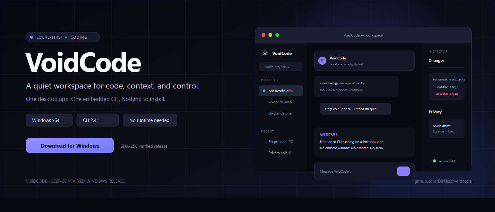

<div align="center">
  
  <h1>VoidCode</h1>
  <p><strong>A local-first AI coding environment.</strong> One desktop app, one embedded CLI, no runtime to install.</p>
  <p>
    
    
    
  </p>
</div>

VoidCode is a focused rebuild of the OpenCode desktop experience: a dark, distraction-free workspace for talking to AI about code, inspecting changes, and keeping everything on your machine. The Windows installer ships with the CLI/server compiled into a standalone executable, so a clean PC can run it with a double-click.

## Highlights

- **Self-contained Windows build** — no Bun, Node.js, dev server, or batch files required.
- **Embedded CLI** — `opencode-cli.exe` is auto-started from app resources on a free loopback port and stopped when VoidCode exits.
- **Liquid Glass** — saturation, inset highlights, volume shadows, wallpaper-aware blur, and native window translucency.
- **Wallpapers** — Pure AMOLED, Obsidian Singularity, Cyber Mesh Grid, or your own image with dimming and blur.
- **VoidCode Studio** — live theme preview, OpenCode JSON theme import/export, instant custom CSS with a kill switch, and shortcut editing.
- **Local-first controls** — Privacy Shield blocks frontend network boundaries; auto-wipe clears local app records.
- **Two languages** — complete English and Russian interfaces with no mixed labels.
- **Clear onboarding** — a short welcome screen instead of a wall of setup steps.

## Screenshots

Captured from the packaged Windows build.


## Download

Grab the v1.1.0 installer from the [GitHub release](https://github.com/Dirfiks3/voidcode/releases/tag/v1.1.0):

| Platform | File |
| --- | --- |
| Windows x64 | `opencode-desktop-win-x64.exe` |

Run it, then launch **VoidCode** from the Start menu. The background service starts automatically.

## What is inside

- Electron desktop shell
- SolidJS renderer
- Standalone Bun-compiled Windows CLI, version `2.4.1`
- Local RPC bridge with Basic auth bound to `127.0.0.1`
- Native terminal and file-system integrations

The app never asks you to pre-start a server on port `4096`. That path is development-only.

## Development

```bash
bun install
bun run dev:live
```

Useful checks:

```bash
bun run typecheck        # in packages/app, packages/ui, or packages/desktop
bun run typecheck:tsc
bun test src             # in packages/desktop
```

Build the standalone CLI, desktop bundle, and installer:

```bash
cd packages/cli
OPENCODE_TARGET=windows-x64-baseline OPENCODE_CHANNEL=latest OPENCODE_VERSION=2.4.1 \
  bun run script/build.ts --skip-install

cd ../desktop
OPENCODE_CHANNEL=prod OPENCODE_TARGET=windows-x64 OPENCODE_VERSION=1.1.0 bun run build
OPENCODE_CHANNEL=prod OPENCODE_TARGET=windows-x64 OPENCODE_VERSION=1.1.0 bun run pack
```

## Credits

VoidCode is built on the open-source [OpenCode](https://github.com/anomalyco/opencode) codebase. OpenCode remains a trademark of its respective owners. VoidCode is an independent local customization and is not affiliated with or endorsed by the OpenCode project.

## License

MIT. See [LICENSE](LICENSE).
